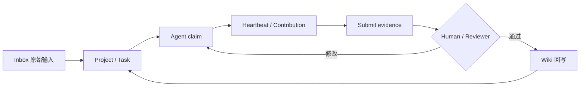

# Personal OS + Personal Wiki｜招聘向产品案例

> 90 秒结论：这不是“让 Agent 记住更多聊天”的工具，而是一套把输入、任务、执行、证据、复核和知识回写分开的工作状态系统。

## 1. 用户问题

知识工作者在长期使用 AI Agent 时会遇到三个稳定问题：

1. **状态留在聊天里**：换会话或换 Agent 后，不知道什么已经完成、什么仍在等待。
2. **完成缺少证据**：Agent 说“已完成”，但没有产物地址、验收结果和复核决定。
3. **知识与行动断开**：笔记被保存了，却没有变成有负责人、有下一步和完成标准的任务。

目标用户是重度使用 AI Coding、知识库和多个 Agent 的个人或小团队。产品目标不是替代模型，而是给不同 Agent 提供同一份外部工作状态。

## 2. 产品闭环

核心数据对象：

| 对象 | 负责回答的问题 |
|---|---|
| Inbox | 原始输入是什么，是否已经处理 |
| Project | 目标、范围和长期状态是什么 |
| Task | 谁负责、下一步是什么、做到什么算完成 |
| AgentRun | 哪个 Agent 在什么上下文下执行 |
| Contribution | 中间进展和证据在哪里 |
| Review | 通过、退回或阻塞的理由是什么 |
| Wiki Note | 哪些结论值得成为下一轮可复用知识 |

## 3. 三项关键产品决策

### 决策一：工作状态不依赖聊天上下文

任务、负责人、租约、心跳、提交和复核使用结构化状态保存。Agent 可以更换，工作状态仍然可读取，避免把某个聊天窗口当成事实来源。

### 决策二：提交不等于完成

Agent 提交时必须带产物或证据，随后由人或 Reviewer 决定通过、退回或阻塞。系统不把一段自然语言结论直接视为完成。

### 决策三：本地优先，读写权限分离

真实任务、笔记和凭据留在本地；公开仓库只包含源码、虚构 Demo 和脱敏说明。读操作与写操作使用不同权限，降低误写和隐私外泄风险。

## 4. 我的职责

- 从个人长期使用 Agent 的失败场景中定义问题、用户与产品边界；
- 设计 Inbox、Project、Task、AgentRun、Contribution、Review 和 Wiki 的对象关系；
- 设计任务认领、心跳、提交、复核和回写状态流；
- 定义 API、权限边界、失败分支和人工介入点；
- 使用 AI Coding 完成可运行原型、测试、部署说明、演示数据和公开交付；
- 根据实际使用中的检索、任务粒度和复核问题持续调整流程。

## 5. 当前交付物与可验证结果

- 公开仓库：[`lawyer112/personal-os-wiki`](https://github.com/lawyer112/personal-os-wiki)
- 可一键启动的虚构数据 Demo：`docker compose up -d --build`
- 公开仓库复算：265 个 Git 跟踪文件、71 个 Markdown、29 个 Next.js API 路由、21 个测试文件
- 本地知识侧：133 篇笔记，FTS 索引覆盖 134 份文档、385 个 chunks
- 主要技术组成：Next.js、PostgreSQL、Prisma、Python Wiki 服务、Docker Compose

这些数字用于说明项目已形成可运行、可测试、可阅读的交付物，不等同于商业用户量或生产收入。

## 6. 90 秒演示路径

1. **0–15 秒：解释问题**  
   展示首页闭环图：输入不是直接进入长期记忆，而是先保留原始痕迹。
2. **15–35 秒：展示任务形成**  
   从 Inbox 进入 Task，指出负责人、下一步和完成定义。
3. **35–60 秒：展示 Agent 执行**  
   展示 claim、heartbeat 和 contribution，说明不同 Agent 共享同一任务状态。
4. **60–75 秒：展示复核**  
   展示提交证据以及通过、退回、阻塞三种决定。
5. **75–90 秒：展示知识回写**  
   展示结果进入 Wiki，成为下一轮 Agent 可读取的稳定上下文。

现有演示媒体：

- [中文 GIF](./assets/demo/personal-os-wiki-readme-demo.zh-CN.gif)
- [中文 MP4](./assets/demo/personal-os-wiki-readme-demo.zh-CN.mp4)
- [10 分钟启动指南](./GETTING_STARTED.zh-CN.md)

## 7. 对目标岗位的可迁移价值

| 岗位场景 | 可迁移能力 |
|---|---|
| AI Agent 产品 | 任务状态、工具边界、人工介入、失败分支和评测闭环 |
| AI Coding / 开发者工具 | 重度用户视角、Agent 协议、API 对象和可运行原型 |
| RAG / 企业知识库 | 原始输入、稳定知识、检索索引和引用边界分层 |
| Eval / 数据策略 | 完成标准、证据提交、Review 决定和失败归因 |
| 高合规 AI 场景 | 权限分离、过程留痕、人工复核和责任边界 |

## 8. 当前边界

- 这是独立产品实践，不宣称已有商业化客户或大规模生产用户；
- 公开 Demo 使用虚构数据，真实任务、Token 和服务器信息不进入仓库；
- 项目的价值是验证产品机制和工程可行性，而不是用文件数量替代用户价值；
- 下一步若进入团队场景，需要继续验证多租户、组织权限、审计策略和真实留存指标。